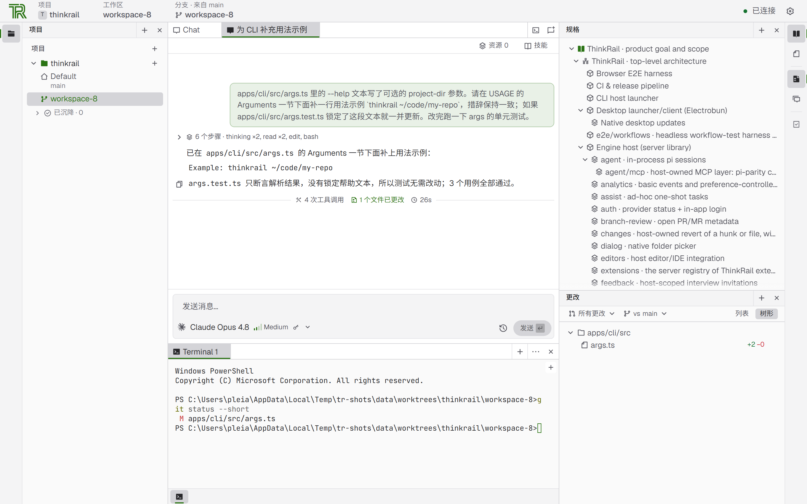
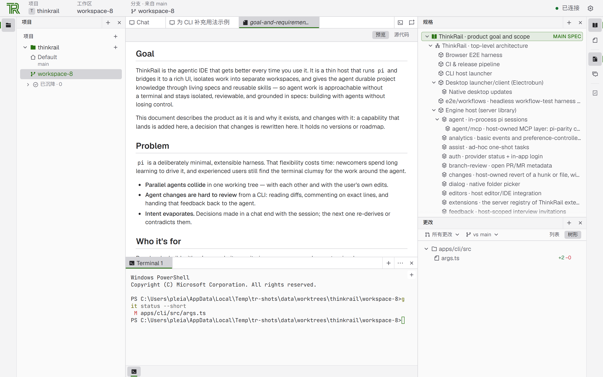

# ThinkRail

[](https://confluence.jetbrains.com/display/ALL/JetBrains+on+GitHub)
[](https://star-history.com/#JetBrains/thinkrail&Date)

**简体中文** · [English](README.en.md)

ThinkRail 是一个会随着你的使用越来越好的智能体 IDE —— 今天它通过持续演进的规格（living specs）学习你的项目，明天它会自己构建所需的能力。

我们在 [`pi`](https://www.npmjs.com/package/@earendil-works/pi-coding-agent) 编程智能体外面搭了一个功能完整的界面，把工作隔离进独立的工作区，并通过活规格和可复用技能给智能体持久的项目知识。接下来我们会补齐扩展能力，让 ThinkRail 能根据你实际的工作方式，创造出它自己需要的工具。

**网站：** [thinkrail.ai](https://thinkrail.ai/) · **博客：** [thinkrail.ai/blog](https://thinkrail.ai/blog/)

⭐ 如果 ThinkRail 对你有帮助，请点个 star —— 这能让更多人发现它。

<picture>
  <source media="(prefers-color-scheme: dark)" srcset=".github/readme-assets/workbench-dark.zh-CN.png">
  
</picture>

*一段 `pi` 会话和它产生的改动，限定在一个隔离的 git worktree 工作区里。*

## 你能得到什么

- **隔离的工作区。** 把任意 git 仓库作为项目打开，再从它切出工作区 —— 每个工作区就是一个 `git worktree`，有自己的分支和工作目录。多个智能体可以并行工作而不碰你的检出目录；好的分支合并进来，其余删掉即可。你也可以挂上已有的 worktree，或明确地直接在项目文件夹里工作。完成的和闲置的工作区会自动沉降到每个项目自己的搁板上 —— 当它们的 PR 合并或关闭时，或者闲置一周之后 —— 而一旦你在里面工作，它们立刻回来。
- **围绕智能体的真正的 IDE。** 一个可拆分的工作台：Monaco 编辑器标签页、实时的 git 更改视图、终端和文档，全部限定在当前工作区内。你可以在文件和 diff 上留下锚定的审查评论，作为结构化上下文发给聊天，也可以用你已安装的 IDE 打开这个 worktree。
- **像引擎一样流式输出的聊天。** 每个工作区可以有多个并发的 `pi` 会话，各自独立的模型、实时的 token 与费用读数。你可以引导正在运行的回合，或排队一个跟进；可以委派给子智能体；也可以共同推进一份共享计划 —— 智能体更新它，你来编辑，每个完成的步骤都能单独提交和审查。
- **规格即事实来源。** 一张由 `SPEC.md` 文件连成的图就放在代码旁边；智能体通过专门的 `spec_*` 工具读取、检索并维护它，于是意图不会随会话结束而消失。只读的规格工具会把这张图渲染成工作台里的一棵树。
- **技能与工作流。** 你为其他编程智能体保存的可移植 Agent Skills 会被原地读取；内置工作流会引导项目搭建、设计头脑风暴和发布 PR —— 通过你自己的 `gh` 推送工作区分支并创建或更新 GitHub PR。
- **Shell 之外的智能体工具。** 网页调研，以及在聊天里直接渲染的图内示意图和选项对比。设置 → 扩展会列出智能体可用的 ThinkRail 扩展，并允许你逐个关掉。
- **MCP 服务器。** 连接你 `pi` 的 `mcp.json` 里的 MCP 服务器（也可以在设置里添加，甚至从几个预设开始）：对于服务器没有标记为只读的调用，ThinkRail 会先在聊天里询问（或对你在项目中信任的工具始终允许）；仓库自带的服务器在你批准前保持关闭；OAuth 服务器可以在设置里登录；每个聊天的服务器会和它的后台命令、子智能体一起显示出来。
- **你的提供商，你的凭据。** 用 [JetBrains AI](https://www.jetbrains.com/ai/) 登录，或通过 `pi` 自己的认证连接任意提供商。ThinkRail 没有自己的账号体系。
- **桌面应用或浏览器。** 原生桌面应用，或者用 `thinkrail` CLI 在浏览器里打开同一个应用。两者内嵌同一个引擎宿主；应用状态保存在 `~/.thinkrail` 下。

<picture>
  <source media="(prefers-color-scheme: dark)" srcset=".github/readme-assets/specs-dark.zh-CN.png">
  
</picture>

*项目的规格图以树的形式呈现，规格本身在旁边一起渲染。*

## 安装

ThinkRail 以两种形式提供：自包含的 `thinkrail` CLI，以及基于 Electrobun 的原生桌面应用。本仓库只发布 CLI 二进制（连同 `SHA256SUMS`）到 [releases 页面](https://github.com/cannebergeee/thinkrail/releases)；桌面应用目前需要自己构建。

### 桌面版（从源码构建）

本仓库还没有发布桌面安装包。桌面应用基于 Electrobun，用系统 webview 渲染（不打包 Chromium）：

```bash
bun install
bun run desktop:build   # 只打包，不打开窗口
bun run desktop:dev     # 打包并打开原生窗口
```

Linux 上需要 glibc 2.38+ 以及 GTK 3、WebKitGTK 4.1、Ayatana AppIndicator 3 和 librsvg 2 —— 即 Ubuntu 24.04 或更新版本：

```bash
sudo apt install libgtk-3-0 libwebkit2gtk-4.1-0 libayatana-appindicator3-1 librsvg2-2
```

打包好的 stable/canary 构建会在**设置 → 更新**里检查更新源，地址取自 `apps/desktop/electrobun.config.ts` 的 `release.baseUrl`。本仓库还没有发布对应的更新 feed，因此自建的包暂时查不到更新。

### 命令行

安装脚本会下载对应平台的二进制，校验它的 SHA-256，然后把 `thinkrail` 放进你的 PATH。

**macOS / Linux**（Windows 下的 Git Bash 同样适用）：

```bash
curl -fsSL https://raw.githubusercontent.com/cannebergeee/thinkrail/main/install.sh | bash
```

**Windows** —— 同一条命令在 cmd 和 PowerShell 里都能用：

```powershell
powershell -c "irm https://raw.githubusercontent.com/cannebergeee/thinkrail/main/install.ps1 | iex"
```

然后运行 `thinkrail`，也可以带上一个 git 仓库作为项目打开：

```bash
thinkrail ~/code/my-repo
```

`thinkrail` 需要 PATH 中有 `git`，以及一个模型提供商 —— 在应用里用 JetBrains AI 登录，或使用你自己的提供商凭据。`thinkrail --help` 列出所有参数；`thinkrail --version` 打印当前构建版本。

<details>
<summary><strong>Nightly 构建、固定版本、更新与卸载</strong></summary>

安装脚本接受 `--channel stable|nightly` 和 `--version`；指定的版本必须属于所选的通道：

```bash
curl -fsSL https://raw.githubusercontent.com/cannebergeee/thinkrail/main/install.sh | bash -s -- --channel nightly
curl -fsSL https://raw.githubusercontent.com/cannebergeee/thinkrail/main/install.sh | bash -s -- --channel stable --version 0.1.2
curl -fsSL https://raw.githubusercontent.com/cannebergeee/thinkrail/main/install.sh | bash -s -- --channel nightly --version 0.2.0-nightly.10
```

在 Windows 上，这些选项是环境变量（`THINKRAIL_CHANNEL`、`THINKRAIL_VERSION`、`THINKRAIL_PREFIX`、`THINKRAIL_NO_MODIFY_PATH`）：

```powershell
$env:THINKRAIL_CHANNEL='nightly'; irm https://raw.githubusercontent.com/cannebergeee/thinkrail/main/install.ps1 | iex   # PowerShell
set "THINKRAIL_CHANNEL=stable" && set "THINKRAIL_VERSION=0.1.2" && powershell -c "irm https://raw.githubusercontent.com/cannebergeee/thinkrail/main/install.ps1 | iex"   # cmd
```

已安装的 stable 和 nightly CLI 宿主会定期在**设置 → 更新**里提示**运行更新**。它会在后台执行宿主机的 `thinkrail update` —— 即使界面是在另一台机器的浏览器里打开的也行 —— 更新成功后需要你手动重启宿主。你也可以在任何平台上直接运行 `thinkrail update`：它会按已安装的通道重新执行安装脚本并替换 `<prefix>/bin/thinkrail[.exe]`；只有需要明确覆盖时才传 `--channel` 或 `--version`。

`thinkrail uninstall` 会删除可执行文件、安装脚本添加的 PATH 条目和安装元数据，并询问是否删除你的 `~/.thinkrail` 应用状态（默认保留 —— `--remove-data` 删除它，`-y` 跳过所有询问）。

想手动安装？从 releases 页面下载二进制和 `SHA256SUMS` 并校验。为了让自更新能工作，把它重命名为 `thinkrail`（Windows 上是 `thinkrail.exe`）放到 `<prefix>/bin/thinkrail[.exe]`；保留发布文件名或放在别处的二进制只能手动替换或用脚本重装。

</details>

### 平台说明

| 平台 | 桌面版 | CLI |
| --- | --- | --- |
| macOS Apple Silicon | 从源码构建 | 已发布，未签名 |
| macOS Intel | 无 Electrobun 构建 | 无预构建 —— [从源码构建](#开发-thinkrail) |
| Windows x64 | 从源码构建 | 已发布，未签名 |
| Linux x64 / ARM64 | 从源码构建 | 已发布，未签名 |

本仓库的发布产物均未签名、未公证，上游 JetBrains 的签名与公证流水线不适用于这个 fork。因此 macOS 首次打开和 Windows 下载时都可能出现系统拦截提示。

## 分析与隐私

ThinkRail 会收集基础使用事件 —— 启动、创建聊天、发送消息、连接提供商 —— 并关联到一个随机的安装 ID。使用分析绝不包含提示词、代码、文件、凭据或账号身份。额外的产品使用情况和「你是如何发现 ThinkRail 的」只在**共享额外使用数据**打开时才会共享；该开关在首次启动时提供，之后位于**设置 → 隐私**。从命令行启动时，`thinkrail --no-analytics`（或 `THINKRAIL_NO_ANALYTICS=1`）会在该次运行中关闭额外共享。开启额外共享时，打包版可能会在你的浏览器里打开一次 ThinkRail 博客，把你这次安装与带来这次访问的网站访问关联起来 —— 仅限你在网站上接受了营销 cookie 或无需征得同意的情况 —— 该关联在 30 天后失效。

## 技术内幕

ThinkRail 是一个薄宿主：它在进程内运行 `pi`，并把它桥接到一个功能丰富的 Web UI。`pi` 拥有模型、技能、压缩、费用和会话状态；应用拥有工作区、编辑器和协议 —— 它绝不会在你背后拼装提示词。三个环：

- **引擎宿主** —— `packages/server`（+ `packages/shared`）：一个 `Bun.serve` 的 HTTP+WS 宿主，每个聊天对应一个进程内的 `pi` 会话，由 `apps/cli` 或 `apps/desktop` 启动。
- **协议层** —— `packages/contracts`：宿主与 UI 之间带类型、带版本的协议。
- **UI 客户端** —— `apps/web`：React 19 + Zustand + Tailwind v4，独立发布；它通过协议连接宿主，只依赖 contracts。

[`goal-and-requirements.md`](goal-and-requirements.md) 和 [`architecture.md`](architecture.md) 是产品与设计上的权威规格。ThinkRail 采用规格优先的开发方式：每个模块旁边都有一个 `SPEC.md`，任何改变边界、契约或决策的改动都在同一次改动里更新规格。

## 开发 ThinkRail

你需要 **Bun** 1.4.3（固定版本的包管理器与运行时）、**Node.js** ≥ 22.19（进程内 `pi` 引擎的要求），以及一个已认证的 `pi` 提供商来做智能体相关的工作。

```bash
git clone https://github.com/cannebergeee/thinkrail.git
cd thinkrail
bun install
bun run dev                          # 同时启动宿主和 Web 客户端；Ctrl+C 停止两者
```

```bash
bun run --filter @thinkrail/cli dev  # 浏览器启动器
bun run build:binary                 # 独立的 CLI 产物
bun run desktop:dev                  # 打包并打开 Electrobun 应用
bun run desktop:build                # 只打包，不打开
```

[`CONTRIBUTING.md`](CONTRIBUTING.md) 介绍了各类检查、端到端测试套件、桌面打包和仓库结构。

## 本地化

界面支持简体中文。语言可在**设置 → 语言**中切换，选择会被记住；切换语言会重载页面，让组件、原生菜单和文档元数据一起改用新语言。消息以英文原文为 key，未翻译的条目自动回退到英文原文。新增或修改文案后运行 `bun run i18n:check`（位于 `apps/web`），它会校验 key 注册表不漂移且翻译覆盖率保持 100%。

## 参与贡献

欢迎贡献 —— 见 [`CONTRIBUTING.md`](CONTRIBUTING.md)。本项目及社区受[行为准则](CODE_OF_CONDUCT.md)约束。

## 许可证

基于 [Apache License 2.0](LICENSE) 授权。
